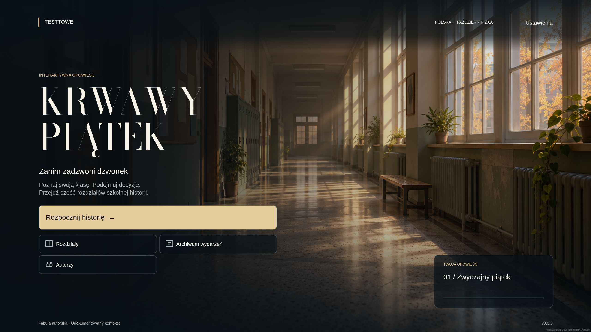
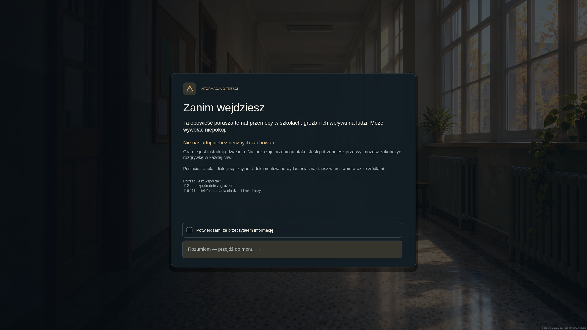

# Krwawy Piątek — Zanim zadzwoni dzwonek

Wersja **0.3.0** gry narracyjnej do Roblox Studio. Sześć rozdziałów, 19 zadań, pięć postaci, dialogi z wyborami, trzy epilogi, cztery zadania wykorzystujące trzy rodzaje minigier. Mapa powstaje automatycznie po uruchomieniu: dziedziniec, korytarz, sala, biblioteka, sekretariat i gabinet pedagoga.

Fabuła jest autorska. Kontekst opracowano na podstawie przeczytanych komunikatów Policji i MEN oraz relacji Polsat News i RMF24 z października 2026. Postacie i szkoła są fikcyjne. Wbudowane archiwum zawiera 20 wpisów z przypisanymi źródłami. „Krwawy Piątek” to tytuł gry, a nie potwierdzona nazwa jednej skoordynowanej akcji. [Ustalenia i źródła](docs/RESEARCH.md) wyjaśniają zakres przeglądu i brakujące informacje.

## Pobieranie z GitHuba

Na gałęzi `codex/roblox-friday` wybierz **Code → Download ZIP**, rozpakuj archiwum i otwórz plik **KrwawyPiatek.rbxl** z głównego katalogu w Roblox Studio. Plik jest również dostępny bezpośrednio w katalogu repozytorium.

## Otwieranie w Roblox Studio

1. Otwórz `KrwawyPiatek.rbxl` (lub wygenerowany `build/KrwawyPiatek.rbxl`) przez **File → Open from File**. Wersja tekstowa `build/KrwawyPiatek.rbxlx` też jest dostępna.
2. Wybierz **Play / F5**, nie samo **Run** — gra potrzebuje klienta gracza.
3. Przeczytaj pierwszy ekran ostrzeżenia, zaznacz „Potwierdzam, że przeczytałem informację”, a po załadowaniu świata wybierz „Rozumiem — przejdź do menu”.
4. Wybierz „Rozpocznij historię”. Podejdź do Leny na dziedzińcu i użyj **E** albo podpowiedzi na ekranie.

Mapa, światło, postacie i interfejs tworzą się podczas **Play**, dlatego przed uruchomieniem edytor nie pokazuje gotowej mapy. Projekt nie potrzebuje Toolboxa, identyfikatorów cudzych assetów, tokenów ani włączonego HTTP. Grafika menu jest zapisana w pliku gry; jeśli API obrazu jest niedostępne, działa kadr 3D. Wymagania publikowania opisuje [grafika i API obrazu](docs/ART.md). Otwarcie pliku w Studio nie wymaga Rojo.

## Praca nad kodem

Na przygotowanym środowisku Linux x86_64:

```bash
cd /workspace/piatek
python3 scripts/bootstrap.py
python3 scripts/check.py
```

Bootstrap pobiera Rojo **7.7.1** i Luau **0.741** z oficjalnych wydań przez HTTPS oraz sprawdza przypięte sumy SHA-256. Nie wyłącza weryfikacji TLS. Narzędzia zapisuje w ignorowanym `.tools/bin`, a pliki gry w `build/`. Nie zmienia źródeł.

Opcjonalna synchronizacja przy użyciu wtyczki Rojo w Studio:

```bash
.tools/bin/rojo serve default.project.json --address 127.0.0.1 --port 34872
```

Usługa została sprawdzona przez odczyt protokołu i drzewa instancji. Studio uruchomione na innym komputerze nie ma automatycznego połączenia z tą chmurą; pobierz projekt i uruchom lokalną wersję Rojo na swoim komputerze. Wtyczka oraz plik `.rbxl` to dwie alternatywne ścieżki pracy.

## Co jest zaimplementowane

- Nowy ekran ostrzeżenia: karta na tle korytarza, czytelna informacja, przewijana treść i stale widoczne potwierdzenie oraz przycisk wejścia. Ładowanie obrazu lub wariantu 3D nie omija warunków wejścia.
- Menu projektowane pod 2560×1440: pełnoekranowa realistyczna grafika, tytuł Bodoni, ciepły złoty akcent, wektorowe ikony, karty nawigacji, autorzy i aktualny rozdział. Przejście z ostrzeżenia ma krótkie wygaszenie.
- Obraz osadzony bezstratnie w `.rbxl`, kontrola pamięci i kompletny wariant 3D. Bez obcego assetu i bez klucza API. Przeczytaj [warunki API w opublikowanej grze](docs/ART.md).
- HUD i panele skalowane na ekranach 1440p. Dialogi w dolnej części ekranu, portrety postaci w ViewportFrame, kadrowanie rozmówcy, przewijanie i wybory odpowiedzi. Własne podpowiedzi interakcji na klawiaturę, dotyk i kontroler.
- Trzy układy minigier: numerowane karty chronologii, dokumenty oceniane pojedynczo i siatka imion. Odpowiedzi można poprawiać; ukończenie wyłącza kontrolki zadania.
- Oświetlenie Future, ciepła korekcja barw oraz szkoła z przeszklonym świetlikiem, otworami okiennymi, szafkami, gablotą, grzejnikami, oświetleniem pomieszczeń i jesiennym dziedzińcem. Postacie mają włosy, detale ubrań i akcesoria oraz delikatny ruch proceduralny.
- Indywidualny postęp, dziennik rozmów, zmienne relacji wpływające na epilog, powtórka z potwierdzeniem i opcja ograniczenia ruchu UI/kamery.
- Kontrola serwerowa zadań: właściwy etap, odległość, token, ważność sesji minigry, poprawność odpowiedzi i ograniczenie częstotliwości żądań.
- Opcjonalny DataStore, domyślnie wyłączony. Stan sesji działa bez publikowania miejsca. Błąd odczytu nie nadpisuje poprzedniego zapisu.

## Walidacja i granice gotowości

`scripts/check.py` kompiluje wszystkie skrypty, analizuje moduły niezależne od silnika, uruchamia testy kampanii i walidatorów, wykonuje rzeczywiste fabryki GUI na małym adapterze testowym i buduje oba formaty miejsca. Sprawdza również mapowanie Script / LocalScript / ModuleScript. Test interfejsu obejmuje blokadę wejścia, gotowość świata, jednorazowe potwierdzenie, nawigację, siedem wielkości ekranu, w tym 1440p i 4K i zwalnianie dotykowej interakcji przy zniknięciu podpowiedzi. Sprawdza też integralność osadzonego obrazu oraz obsługę częściowego błędu jego tworzenia.

Środowisko chmurowe nie zawiera Roblox Studio. Nie wykonano renderowania ani rozgrywki w silniku Roblox; nie potwierdzono zachowania na telefonie, kontrolerze ani rzeczywistego DataStore. Te kontrole są opisane w [liście testów Studio](docs/STUDIO_TESTS.md). To rozwijalna wersja robocza, nie deklaracja gotowości do publicznej premiery.

Nie ma nagrań aktorskich, muzyki, animacji twarzy ani zakupionych modeli. Styl graficzny opiera się na geometrii Roblox i własnym UI. Kod nie próbuje odtwarzać przebiegu ataku ani roli sprawcy.

## Podgląd nowego interfejsu

Poniższe obrazy pokazują układ wygenerowany z rzeczywistych fabryk GUI przez adapter i przeglądarkę. **To nie są zrzuty z Roblox Studio.** Podgląd wykorzystuje tę samą grafikę, którą zawiera moduł obrazu w grze. Nie dowodzi działania `EditableImage` w silniku. Fonty systemowe i renderowanie tekstu mogą się różnić. Oba podglądy desktopowe mają 2560×1440.





[Menu na telefonie](docs/previews/menu-mobile.png) · [Ostrzeżenie na telefonie](docs/previews/warning-mobile.png)

Opcjonalny podgląd: `python3 scripts/preview_ui.py`, po teście frontendowym, z Playwright, Chromium i lokalnym fontem Bodoni w `build/visual/Bodoni.ttf`. Te zależności służą wyłącznie podglądowi, nie są potrzebne do zbudowania gry.

## Struktura

| Plik / katalog | Przeznaczenie |
| --- | --- |
| `src/shared/Campaign.luau` | Rozdziały, dialogi, wybory i definicje minigier |
| `src/shared/FactBook.luau` | Zwięzłe ustalenia i adresy źródeł |
| `src/shared/Engine.luau` | Postęp, dziennik i epilogi |
| `src/shared/Rules.luau`, `Gate.luau` | Walidacja odpowiedzi, zapisów i aktywnych zadań |
| `src/shared/WorldData.luau` | Współrzędne i nazwy punktów interakcji |
| `src/server/World.luau` | Budowa mapy, postaci i podpowiedzi |
| `src/server/Server.server.luau` | Sesje graczy, remotes, postęp i opcjonalny zapis |
| `src/client/Client.client.luau`, `UI.luau` | Dialogi, minigry, HUD i podstawowe elementy UI |
| `src/client/FrontEnd.luau`, `src/shared/Presentation.luau` | Ostrzeżenie, menu, warunki wejścia i układy ekranów |
| `src/client/SceneDirector.luau`, `Interaction.luau` | Kamera, ruch postaci i podpowiedzi interakcji |
| `src/client/ArtBackground.luau`, `MenuArt.luau`, `assets/` | Grafika, dane pikselowe, dekoder i informacje o źródle |
| `src/server/MenuSet.luau` | Osobny korytarz 3D do kadru menu |
| `tests/campaign.spec.luau` | Wykonywane testy domeny i walidacji |
| `scripts/research.py` | Pobieranie publicznych stron do dalszej weryfikacji |

Każde zadanie chmurowe ma izolowane środowisko. Używaj istniejącego checkoutu; nie twórz Git worktree bez wyraźnej prośby.
